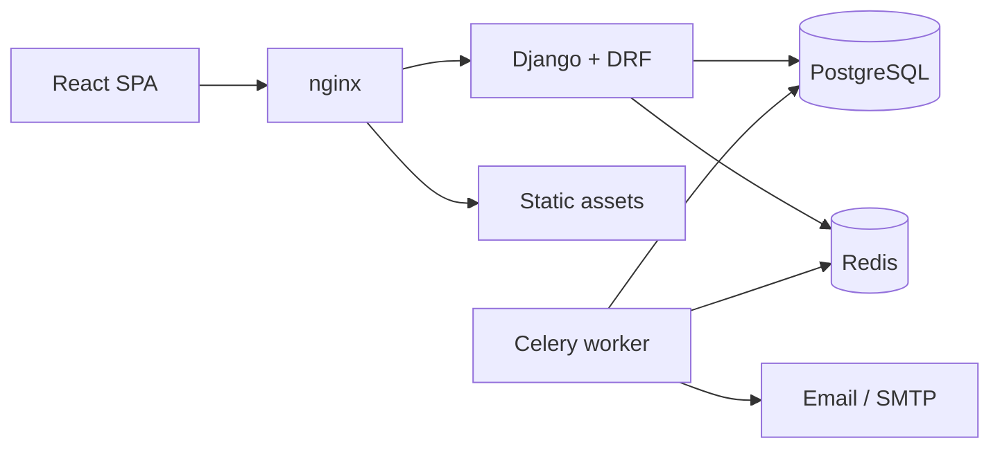

# Mawid

**Mawid** (موعد) is an appointment booking platform for small businesses such as clinics, salons, barbers, gyms, and tutors. Businesses publish their services and working hours, and customers book available slots online. Staff manage appointments from a calendar while customers receive confirmation and reminder emails.

The application is bilingual: **Arabic (RTL)** and **English (LTR)**.

> **Status:** Foundation and core domain model complete. The Django API shell, JWT authentication, bilingual React shell, CI, business/catalog/scheduling/bookings models, repositories, overlap protection, and demo seed data are in place. Availability and the customer booking flow are next.

---

## Features

### Customer

- Browse services and staff for the business
- See real-time availability by date, service, and staff member
- Book an appointment without creating an account
- Receive confirmation and reminder emails
- Cancel or reschedule through a secure management link
- Add the appointment to a calendar with an `.ics` download
- Use the full flow in Arabic (RTL) or English (LTR)

### Staff and admin

- Secure staff login
- Day and week calendar views
- Appointment details drawer with status actions
- Mark appointments as completed or no-show
- Manage services, staff, working hours, and time off
- Configure business timezone, locale, currency, slot interval, and cancellation policy

### Platform

- Concurrency-safe booking with database-level overlap prevention
- Timezone-aware slot generation, including DST handling
- Localized emails and calendar invites
- Responsive, accessible UI with keyboard navigation and WCAG 2.1 AA targets
- Docker-based development and production deployment
- Automated linting, type checking, tests, and CI/CD

---

## Tech stack

| Layer | Technology |
|---|---|
| Backend | Python 3.12, Django 5, Django REST Framework |
| Async tasks | Celery, Redis |
| Database | PostgreSQL |
| Frontend | React, TypeScript, Vite, React Router, React Query |
| Styling and UI | Tailwind CSS, shadcn/ui, Radix primitives, lucide-react |
| Internationalization | i18next / react-i18next, Django i18n, RTL layouts |
| Infrastructure | Docker Compose, nginx, GitHub Actions, GHCR |
| Quality | ruff, mypy, pre-commit, pytest, factory_boy, Vitest, React Testing Library, Playwright |

---

## Architecture

The backend follows a layered architecture inside each Django app:

```text
presentation/   DRF views and serializers (thin, no business logic)
application/    use cases and services (booking, cancellation, availability)
domain/         entities, value objects, policies, protocols
infrastructure/ Django ORM repositories, email senders, clock, Celery tasks
container.py    composition root that wires implementations to interfaces
```

Dependencies point inward: `presentation -> application -> domain`, with `infrastructure` implementing domain protocols. Services use constructor injection, so tests can pass fakes instead of mocking Django internals.

The frontend is organized by feature (`features/booking`, `features/calendar`, and so on). Hooks hold logic, components stay presentational, and the API client is injected through React context.



---

## Project structure

```text
mawid-booking/
  backend/
    config/                 Django settings, URLs, Celery, ASGI
    apps/
      core/                 Health, errors, clock, pagination, localization
      accounts/             User, auth, permissions
      businesses/           Business and settings
      catalog/              Services, staff, staff-service assignments
      scheduling/           Working hours, time off, slot generation
      bookings/             Customers, appointments, booking lifecycle
      notifications/        Reminders, email rendering, .ics
    tests/
  frontend/
    src/
      app/                  Providers, router, layouts
      features/             Booking, manage, calendar, services, staff, settings
      shared/               UI components, API client, i18n, auth, utilities
        i18n/locales/       Translation files (en, ar)
    tests/
  infra/                    nginx and Docker Compose files
  .github/workflows/        CI and deployment pipelines
  docker-compose.yml
  Makefile
```

Product specifications and implementation planning notes are kept locally in `local-docs/`, which is intentionally gitignored.

---

## Getting started

### Prerequisites

- Docker and Docker Compose
- Node.js 20+ and Python 3.12+ if running services outside Docker
- `make` (optional, for convenience commands)

### Run the stack

```bash
git clone <repository-url> mawid-booking
cd mawid-booking
cp .env.example .env
docker compose up --build
```

Once the scaffold is in place, the services will be available at:

| Service | URL |
|---|---|
| Frontend | http://localhost:5173 |
| Backend API | http://localhost:8000/api/ |
| OpenAPI schema | http://localhost:8000/api/schema/ |
| Health check | http://localhost:8000/health |
| Mailpit (development email) | http://localhost:8025 |

The API health check is available at http://localhost:8000/health and interactive API documentation at http://localhost:8000/api/docs/.

### Demo data

Create or refresh the idempotent demo clinic, staff, services, working hours, customers, and appointments:

```bash
docker compose exec backend python manage.py seed_demo
```

The demo owner is `owner@mawid.local` with the password `mawid-demo-123`; set `MAWID_DEMO_PASSWORD` to override it.

---

## API overview

The endpoints below are the frozen MVP contract. They are implemented incrementally as features land.

| Method | Endpoint | Description |
|---|---|---|
| `GET` | `/api/business/` | Business profile and configuration |
| `GET` | `/api/services/` | Active services |
| `GET` | `/api/staff/?service=` | Staff available for a service |
| `GET` | `/api/availability/?service=&staff=&date=` | Free slots for a date |
| `POST` | `/api/appointments/` | Create a booking |
| `GET` | `/api/appointments/manage/{token}/` | View a booking via management link |
| `POST` | `/api/appointments/manage/{token}/cancel` | Cancel a booking |
| `POST` | `/api/appointments/manage/{token}/reschedule` | Reschedule a booking |
| `GET` | `/api/appointments/manage/{token}/ics` | Download a calendar invite |
| `POST` | `/api/auth/token/` | Staff login |
| `GET` | `/api/calendar/?from=&to=` | Staff calendar data |
| `PATCH` | `/api/appointments/{id}/status/` | Update appointment status |

API errors use a stable machine-readable `code` plus a translated `detail`, for example:

```json
{
  "code": "slot_taken",
  "detail": "هذا الموعد لم يعد متاحاً",
  "fields": {},
  "request_id": "..."
}
```

---

## Quality checks

Use the Makefile for local checks:

```bash
make lint          # ruff + ESLint
make typecheck     # mypy + tsc
make test          # pytest + Vitest
make test-e2e      # Playwright
make i18n-check    # translation key parity
```

Quality gates:

- 85% backend coverage overall
- 95% coverage on `domain/` and `application/`
- Component accessibility checks with `jest-axe`
- Playwright accessibility and screenshot checks
- Lighthouse accessibility score of at least 90
- CI blocks merges when lint, typing, tests, or translation parity fail

---

## Internationalization

- Supported locales: `en` and `ar`
- Language detection order: `?lang=` query parameter, saved preference, staff profile, browser language, default
- The selected language is persisted and applied to `<html lang>` and `<html dir>`
- Dates, times, numbers, and currency use the `Intl` APIs
- Business data is stored in both languages with fallback
- Appointments store the customer's language so later emails use the correct locale
- Emails and `.ics` files are rendered in the customer's language

Adding a new language should require configuration and translation files only, with no service logic changes.

---

## Deployment

Production deployment uses:

- Multi-stage Docker images for backend and frontend
- nginx as reverse proxy and static file server
- PostgreSQL and Redis with persistent volumes
- Celery worker and beat as separate services
- GitHub Actions to build, push to GHCR, deploy over SSH, and run a smoke test
- HTTPS via certificates mounted into nginx

---

## Roadmap

The MVP includes booking, cancellation, rescheduling, reminders, staff calendar, bilingual UI, and deployment.

Explicitly out of scope for now:

- Online payments
- SMS or WhatsApp providers
- Native mobile applications
- Multi-business tenancy in a single deployment
- Advanced calendar features such as drag-and-drop rescheduling

---

## License

License to be determined.
